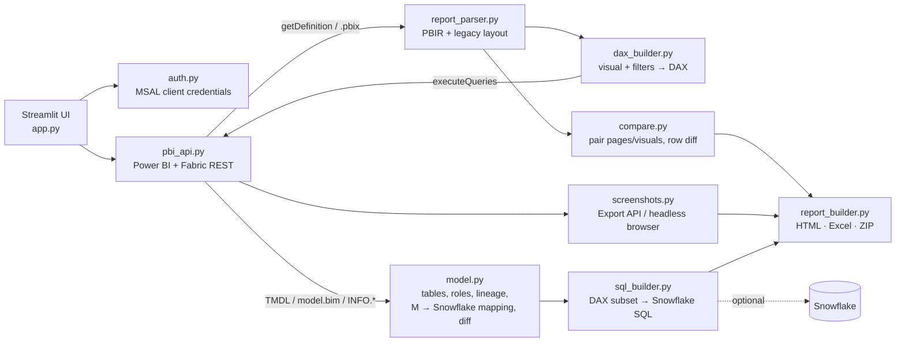

# Power BI Prod ↔ Test visual comparison

A Streamlit app that compares a **Production** and a **Test** Power BI report visual by visual
and produces a report with screenshots, highlighted row-level differences, a semantic-model diff
and Snowflake SQL to validate every number at the source.

| You choose independently for each side | The app does |
|---|---|
| Workspace · Report · Pages (all or specific) | Reads report layout (pages, visuals, fields, all filters, slicers, bookmarks) |
| The semantic model's workspace (auto-detected, can differ from the report's) | Reads and **understands both semantic models** automatically (mandatory) |
| Every filter / slicer on the page - Year, Month, … - **As saved / All / specific values** | Lists them with live values from the model |
| Which views to compare: the page as saved and each bookmark "tab" | Compares every visual in every chosen view |
| Tolerances, screenshot engine | Runs one DAX query per visual, per side, with every filter applied |
| | Pairs visuals, diffs rows, highlights mismatched / missing / extra rows |
| | Captures a screenshot of every page and every visual (mandatory) |
| | Generates Snowflake validation SQL per visual for both environments |
| | Exports HTML report, highlighted Excel workbook and a ZIP bundle |

Try it without a tenant: pick **Demo** in the tenant drop-down.

---

## Hosting: why not github.io

GitHub Pages only serves static files. This app needs a Python server for the service-principal
sign-in, the Power BI REST calls, the DAX queries and the headless browser that takes screenshots.
So the setup is:

* **Code** - this GitHub repository.
* **App** - Streamlit Community Cloud, deployed straight from the repo (free, redeploys on push).
* **github.io** - `docs/index.html` shows the app inside the github.io page, so the link you hand
  out is the github.io one. Enable it under *Settings → Pages → Deploy from branch → `/docs`* and
  set `APP_URL` in that file to your Streamlit URL. If a browser refuses to frame the app, the page
  falls back to an "Open the app" button.

### Sharing the github.io link with other users
* Users only need a browser - nothing is installed on their computers. Each user gets an
  independent session; selections and results are not shared between users.
* For the app to show inside the github.io page it must be **public** on Streamlit Community Cloud
  (private Streamlit apps require Streamlit sign-in, which browsers won't allow inside a frame).
  Protect a public app with `[admin].viewer_passcode` in the secrets - everyone must enter it first.
* If you prefer a private Streamlit app (invite-only by e-mail), users click *Open in a new tab* on
  the github.io page instead.

> Streamlit Community Cloud runs the app on Streamlit's infrastructure; the client secret lives in
> its encrypted Secrets store and report data passes through that server. If your security team
> requires data to stay in Azure, the same repo runs unchanged in a container
> (`streamlit run app.py`) on Azure App Service / Container Apps.

---

## Architecture



```
app.py                       Streamlit UI (5 steps: select → understand → filters → compare → report)
pbi_compare/
  config.py                  tenant profiles from secrets, owner overrides, settings
  auth.py                    service-principal tokens (Power BI + Fabric scopes)
  pbi_api.py                 REST client: workspaces, reports, pages, executeQueries, ExportTo, getDefinition
  report_parser.py           PBIR + legacy report.json + .pbix Layout → pages / visuals / fields / filters
  model.py                   TMDL / BIM / INFO parser, table roles, measure lineage, M source resolver, model diff
  dax_builder.py             filters → DAX filter tables, visual → SUMMARIZECOLUMNS query, global filters
  sql_builder.py             DAX-subset → Snowflake SQL compiler, join paths from relationships
  compare.py                 page/visual pairing, row-level diff with tolerances, highlighting
  screenshots.py             Export-To-File PNG or Playwright + powerbi-client, cropping, status outlines
  runner.py                  orchestrates a run
  report_builder.py          HTML / Excel / ZIP outputs
  snowflake_runner.py        optional: run validation SQL in Snowflake
  demo.py, samples.py        offline demo + test fixtures
docs/index.html              GitHub Pages landing page
tests/                       unit tests + Streamlit end-to-end smoke test (demo mode)
```

---

## Setup (one time, per tenant)

### 1. Register the app in Microsoft Entra ID
1. *Entra admin center → App registrations → New registration* (single tenant).
2. *Certificates & secrets → New client secret*. Keep the value.
3. Don't add Power BI API permissions to the app - service principals get access through
   workspace roles, not API permissions.
4. Create a security group (e.g. `sg-pbi-compare`) and add the app's service principal.

### 2. Fabric / Power BI admin portal → Tenant settings
Enable each for the security group above:

| Setting | Needed for |
|---|---|
| *Service principals can use Fabric APIs* (older name: *Allow service principals to use Power BI APIs*) | everything |
| *Dataset Execute Queries REST API* | the per-visual DAX queries |
| *Export reports as image files* | screenshots via Export API (capacity workspaces) |
| *Embed content in apps* | screenshots via headless browser (shared-capacity workspaces) |

### 3. Workspace access
Add the security group as **Contributor** or **Member** to every workspace involved: the
Production and Test **report** workspaces *and*, when the semantic models live elsewhere, the
**model** workspaces too. (Viewer is not enough to read report/model definitions; on a model
workspace, Viewer + *Build* permission on the semantic model is enough for queries, but
Contributor is needed to read the model definition - otherwise the app falls back to DAX `INFO`
functions.)

**Models in a separate workspace** (thin / live-connected reports): the app reads the report's
`datasetWorkspaceId`, or searches the workspaces the service principal can see, and uses that
workspace for every DAX query, the model definition and refresh history. It's shown under
*Semantic model location* for each side and can be changed there.

### 4. Deploy on Streamlit Community Cloud
1. Push this folder to a GitHub repository.
2. [share.streamlit.io](https://share.streamlit.io) → *Create app* → pick the repo, branch, `app.py`,
   Python 3.12.
3. *Advanced settings → Secrets*: paste the contents of `.streamlit/secrets.toml.example` with your
   real values.
4. After it deploys: *Settings → Sharing → "Only specific people can view this app"* and invite your
   team - the app can see whatever the service principal can.
5. `packages.txt` installs Chromium for the browser screenshot engine; first boot takes a few minutes.

Local run: `pip install -r requirements.txt && playwright install chromium && streamlit run app.py`.

### 5. Tenant flexibility for the owner
* Each `[tenants.<key>]` block in secrets is one tenant; the app talks only to the one selected.
* With `[admin].owner_passcode` set, the owner can unlock **Owner settings** in the sidebar and
  change the tenant ID, client ID, secret and allowed workspaces for the session (nothing is
  written to disk). Permanent changes go in the Secrets store.
* `allowed_workspaces` limits the workspace pickers per tenant.

---

## Filters, slicers, buttons and tabs

After you pick the pages, the app lists **every filter a user could change on those pages**:
report-level filters, page filters and every slicer (list, dropdown, tile, button slicers,
date hierarchy slicers such as Year + Month). For each one choose:

* **As saved** - use the selection saved in each report (default).
* **All** - clear it (the saved selection is removed in both reports).
* **Choose** - pick values from a list read live from the semantic model (months are listed in
  calendar order).

Choices apply to both reports - data, screenshots and SQL - on **every page being compared**: the
pages you selected, or every page when *All pages* is on, including pages that have no slicer for
that field (the choice is added as a page filter there). A field used on several pages is set once. A slicer holding several levels (Year + Month) stores one selection, so set each
level you want.

**Tabs inside one page / buttons**: these are bookmarks that show and hide visuals. Every bookmark
on a page is offered as a *view*; by default the page as saved and every bookmark view are compared.
Visuals hidden in a view are skipped for that view (and compared in the view that shows them).
Bookmarks are matched between Prod and Test by name, then display name.

Buttons are read too: bookmark buttons are shown next to the view they open, and page-navigation
or drill-through buttons that lead to pages outside your selection are flagged so you can add those
pages. The *Bookmarks / tabs* tab under Model insights lists every button and what it opens.

## How a comparison works

1. **Understand the models (mandatory).** Each report's layout is read with Fabric
   `getDefinition` (PBIR or legacy layout), falling back to downloading the `.pbix`. Each semantic
   model is read as TMDL (or `model.bim`), falling back to DAX `INFO.*` / `INFO.VIEW.*` functions.
   The app then works out fact / dimension roles, relationship directions, measure dependency
   lineage (visual → measures → columns → Snowflake objects), the Snowflake object behind every
   table (resolving Power Query parameters like `DatabaseName`), and a full Prod ↔ Test model diff.
2. **Filters.** For every visual the effective filter set is: report filters + page filters +
   current slicer selections on the page (respecting *Edit interactions*) + visual filters + your
   global filters. Supported: basic/advanced (In, Not In, comparisons, Between, Contains,
   StartsWith, blanks, And/Or), Top N, and measure filters on the visual.
3. **Pairing.** Pages pair by page ID, then display name (or directly when you pick one page per
   side). Visuals pair by visual ID → type + title → type + fields → type + nearest position.
4. **Data.** One `SUMMARIZECOLUMNS` query per visual per side through `executeQueries`. Results are
   joined on the grouping columns (tables, matrix rows + columns, chart axes, legends) and each value
   compared with absolute / relative tolerance. Statuses: *Match, Mismatch, Only in Production,
   Only in Test*. Mismatched cells are bold red, rows are tinted.
5. **Screenshots (mandatory).** *Auto* uses the Export-To-File API on Premium/Fabric/PPU
   workspaces and a headless Chromium with `powerbi-client` elsewhere; if Export fails it retries in
   the browser. When you change filter/slicer selections, *Auto* always uses the browser, because
   only it can replace slicer selections (it applies bookmarks, then your choices, per view). Each visual is cropped from its page image and every page is outlined green / red by
   result.
6. **SQL.** For each visual and each environment: base fact table, `LEFT JOIN`s along active
   relationships, translated measures, `WHERE` from filters, `HAVING` for measure filters, ordered
   like the visual. Measures translated automatically: `SUM / AVERAGE / MIN / MAX / COUNT /
   COUNTA / COUNTROWS / DISTINCTCOUNT`, the `…X` iterators, `DIVIDE`, `IF`, `SWITCH(TRUE())`,
   `VAR/RETURN`, nested measures and `CALCULATE` with column filters. Anything else is emitted as
   `NULL /* TODO … original DAX … */` and the visual is flagged *needs review* - the SQL is never
   silently wrong. Override any table's Snowflake object on the *Snowflake mapping* tab.
7. **Report.** HTML (self-contained, screenshots embedded), Excel (summary, model diff, one
   highlighted sheet per visual, all SQL) and a ZIP with the HTML, Excel, every PNG, `.sql` and `.dax`.
   SQL generation can be switched off in the sidebar, and SQL / DAX can be left out of the report
   with toggles on the Report tab.

---

## Known limits and how to handle them

| Situation | Behaviour |
|---|---|
| Relative date / relative time filters | Skipped with a warning on the visual (both sides treated the same). Add an equivalent global filter if needed. |
| Row-level security models | Service principals can't impersonate users in `executeQueries`; compare against a non-RLS copy or an RLS-free test role. |
| Visual calculations, field parameters, calculation groups | Field is excluded from the query with a warning. |
| Bookmarks, drill-through, personal bookmarks | The saved default state of each page is compared. |
| Conditional formatting, colours, sort order | Not data - visible in the screenshots, not diffed. |
| More than 100,000 rows in one visual | `executeQueries` limit; the visual is flagged as capped. |
| Export API throttling | One export per page (visuals are cropped), retried with back-off. |

## Suggestions for next iterations
* Schedule nightly runs with GitHub Actions and email the HTML report.
* Store run history (Azure Blob / Snowflake table) to trend differences over releases.
* Pixel diff between Prod and Test screenshots to catch formatting regressions.
* Certificate credentials instead of a client secret; Key Vault for secrets if moving to Azure.

## Tests
`pytest -q` runs the parser / DAX / SQL / diff unit tests and a full Streamlit end-to-end run in demo
mode (GitHub Actions workflow included).
